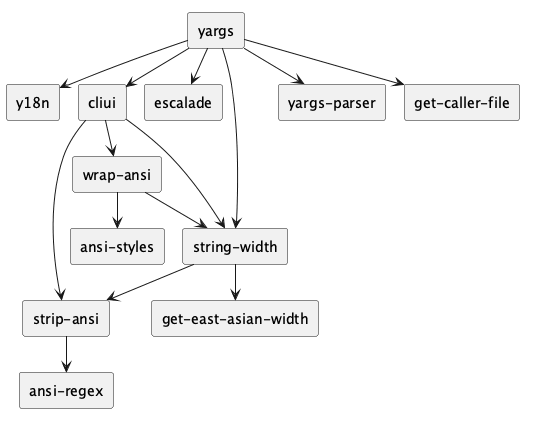
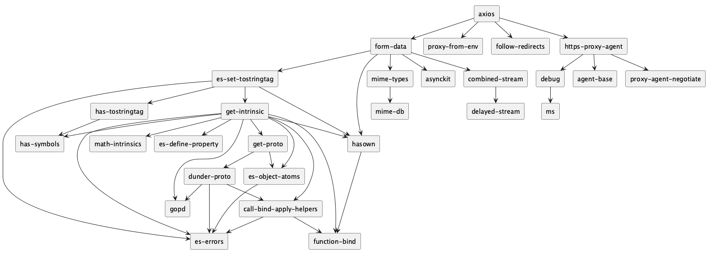
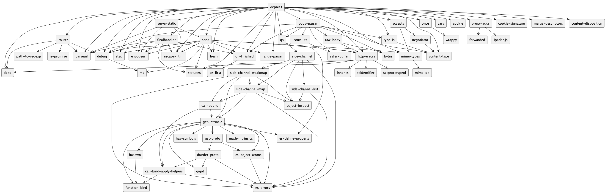
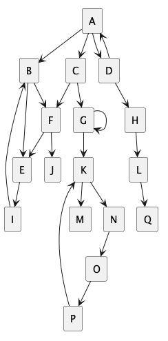

# Визуализация графа зависимостей npm-пакетов

Практическая работа №2 по дисциплине «Конфигурационное управление», вариант 15.

## Общее описание

Инструмент командной строки для анализа зависимостей пакетов npm.
Зависимости берутся напрямую из репозитория пакетов (по умолчанию
https://registry.npmjs.org), менеджеры пакетов и сторонние библиотеки
не используются. Программа написана на Python 3, нужна только
стандартная библиотека.

Алгоритм обхода графа тестового репозитория дополнительно реализован на
JavaScript, Java, Kotlin, C#, Go и Rust. Выводы всех семи реализаций
сверяются между собой и с ответами, составленными вручную.

Оформление репозитория намеренно нарушает все правила из перечня
нарушений оформления git-репозитория, по каждому языку из перечня (см.
раздел «Нарушения оформления»). Программа при этом выполняет все
требования этапов, все тесты проходят.

## Этапы

| Этап | Ветка |
|---|---|
| 1. Минимальный прототип с конфигурацией | https://github.com/GoDeXxXx/npm-dependency-graph/tree/stage-1 |
| 2. Сбор данных | https://github.com/GoDeXxXx/npm-dependency-graph/tree/stage-2 |
| 3. Основные операции | https://github.com/GoDeXxXx/npm-dependency-graph/tree/stage-3 |
| 4. Дополнительные операции | https://github.com/GoDeXxXx/npm-dependency-graph/tree/stage-4 |
| 5. Визуализация | https://github.com/GoDeXxXx/npm-dependency-graph/tree/stage-5 |

Каждый этап сохранён одним коммитом в формате Conventional Commits с
подробным описанием.

Готовы этапы:

1. Разбор и проверка параметров командной строки.
2. Получение прямых зависимостей пакета из репозитория npm.
3. Построение графа зависимостей с учётом транзитивности, глубины,
   фильтра и циклов; режим тестового репозитория.
4. Обратные зависимости (пакеты, которые зависят от данного); тот же
   обход на шести других языках.
5. Визуализация: текст на языке PlantUML, картинка PNG, ASCII-дерево;
   сравнение с выводом `npm ls`.

## Параметры

| Параметр | По умолчанию | Описание |
|---|---|---|
| `--package ИМЯ` | обязательный | имя анализируемого пакета |
| `--repo АДРЕС` | `https://registry.npmjs.org` | URL-адрес репозитория или путь к файлу тестового репозитория |
| `--test-mode` | выключен | режим работы с тестовым репозиторием |
| `--output ФАЙЛ` | `graph.png` | имя файла с изображением графа, рядом сохраняется текст PlantUML `.puml` |
| `--ascii-tree` | выключен | вывод зависимостей в виде ASCII-дерева |
| `--max-depth N` | `5` | максимальная глубина анализа зависимостей |
| `--filter ПОДСТРОКА` | не задан | пакеты, в имени которых есть подстрока, не учитываются |
| `--reverse` | выключен | вывести обратные зависимости, только для тестового репозитория |

На этапе 1 программа при запуске выводила все параметры в формате
`ключ=значение`, начиная с этапа 2 этот вывод убран.

## Проверка параметров

Ошибка выводится в поток ошибок в виде `Ошибка: текст`, программа
завершается с кодом 1. Ошибки разбора командной строки (неизвестный
параметр, значение у флага) выводит модуль `argparse`, код возврата 2.

| Параметр | Что проверяется |
|---|---|
| `--package` | задан; имя npm: строчные латинские буквы, цифры, `-._~`, не начинается с точки, не длиннее 214 символов, может быть с областью `@scope/name`; в тестовом режиме только большие латинские буквы |
| `--repo` | задан; без тестового режима это URL с протоколом `http` или `https`; в тестовом режиме это существующий файл |
| `--test-mode` | флаг без значения; в этом режиме `--repo` должен быть путём к файлу |
| `--output` | задан; расширение `.png`; не папка; папка для файла существует |
| `--ascii-tree` | флаг без значения |
| `--max-depth` | целое число от 1 до 100 |
| `--filter` | не пустая строка; имя анализируемого пакета не должно её содержать |
| `--reverse` | флаг без значения; только вместе с `--test-mode` |

## Получение зависимостей

Используется формат пакетов npm. Описание последней версии пакета
запрашивается по адресу `<репозиторий>/<имя пакета>/latest`, например
https://registry.npmjs.org/express/latest. У пакетов с областью символ `/`
кодируется: `@babel/core` превращается в `@babel%2Fcore`. Прямые
зависимости берутся из поля `dependencies` полученного JSON. Запрос
делается модулем `urllib` из стандартной библиотеки, ответ разбирается
модулем `json`.

Подходит любой репозиторий с тем же форматом, например зеркало
https://registry.npmmirror.com.

На этапе 2 программа выводила только прямые зависимости пакета и
диапазоны их версий (`form-data ^4.0.6`), с этапа 3 вместо этого
выводится весь граф.

Для каждого пакета берётся его последняя версия (`latest`), диапазоны
версий из `dependencies` не разрешаются.

Ошибки при обращении к репозиторию:

| Ситуация | Сообщение |
|---|---|
| пакета нет (ответ 404) | `пакет X не найден в репозитории URL` |
| другой код ответа HTTP | `репозиторий вернул ошибку N для пакета X` |
| сервер недоступен | `не удалось подключиться к репозиторию URL: причина` |
| ответ не JSON | `репозиторий вернул не JSON для пакета X` |
| неверная структура JSON | `неверный формат описания пакета X` |

## Граф зависимостей

Граф строится обходом в ширину (BFS) без рекурсии, функция `bfs` в
`python/graph.py`. В очереди лежат пакеты, которые ещё нужно раскрыть,
для каждого пакета запоминается его глубина: у анализируемого пакета 0,
у его прямых зависимостей 1 и так далее.

- **Глубина.** Раскрываются только пакеты с глубиной меньше
  `--max-depth`. Пакеты на последнем уровне попадают в граф как
  зависимости, но их собственные зависимости не запрашиваются.
- **Фильтр.** Пакеты, в имени которых есть подстрока `--filter`, не
  попадают в граф и не раскрываются. Сравнение учитывает регистр.
- **Циклы.** Каждый пакет ставится в очередь один раз, поэтому цикл
  A → B → A не приводит к бесконечному обходу. Ребро, замыкающее цикл,
  остаётся в графе.

Граф выводится в порядке обхода, по строке на каждый раскрытый пакет:
`пакет: зависимости через пробел`. Пакет без зависимостей выводится как
`пакет:`. Если пакета нет в начале строки, значит, он не раскрывался
из-за ограничения глубины.

```
$ ./start.sh --package axios --max-depth 2
axios: form-data proxy-from-env follow-redirects https-proxy-agent
form-data: hasown asynckit mime-types combined-stream es-set-tostringtag
proxy-from-env:
follow-redirects:
https-proxy-agent: debug agent-base proxy-agent-negotiate
```

## Тестовый репозиторий

С флагом `--test-mode` параметр `--repo` задаёт путь к файлу с описанием
графа. Пакеты называются большими латинскими буквами, каждая строка
описывает один пакет и его прямые зависимости:

```
# цикл A -> B -> C -> A, из C есть выход в D
A: B
B: C
C: A D
D:
```

Пустые строки и всё после `#` пропускаются. Каждый пакет описывается
один раз, все зависимости тоже должны быть описаны в файле.

| Ошибка в файле | Сообщение |
|---|---|
| нет двоеточия | `файл, строка N: нет двоеточия после имени пакета` |
| неверное имя | `файл, строка N: имя пакета 'b' должно состоять из больших латинских букв` |
| пакет описан дважды | `файл, строка N: пакет A описан повторно` |
| зависимость указана дважды | `файл, строка N: у пакета A повторяется зависимость` |
| зависимость не описана | `пакет C, от которого зависит A, не описан в файле ...` |
| пустой файл | `в файле ... нет ни одного пакета` |
| анализируемого пакета нет | `пакет Z не описан в файле ...` |

Тестовые репозитории лежат в `repos/`:

| Файл | Что проверяет |
|---|---|
| `simple.txt` | общая зависимость у двух пакетов |
| `chain.txt` | цепочка из 6 пакетов, ограничение глубины |
| `cycle.txt` | цикл A → B → C → A |
| `self.txt` | пакеты, зависящие сами от себя |
| `filter.txt` | пакеты с `X` в имени для проверки фильтра |
| `complex.txt` | несколько циклов, общие зависимости, длинные ветки |
| `errors/*.txt` | файлы с ошибками |

В `repos/cases.txt` перечислены случаи обхода (файл, пакет, глубина,
фильтр, направление), а в `repos/expected/` лежат ожидаемые выводы,
составленные вручную. Тесты сверяют с ними вывод программы.

```
$ ./start.sh --package A --repo repos/complex.txt --test-mode --filter K
A: B C D
B: E F
C: F G
D: A H
E: I
F: E J
G: G
H: L
I: B
J:
L: Q
Q:
```

## Обратные зависимости

С флагом `--reverse` программа выводит пакеты, которые зависят от
заданного: сначала напрямую, затем через другие пакеты. Для этого все
рёбра тестового репозитория разворачиваются (функция `reverse_edges` в
`python/graph.py`), и по развёрнутому графу запускается та же функция
`bfs`, что и на этапе 3. Поэтому глубина, фильтр и циклы обрабатываются
так же.

Вывод в том же формате, но строка `D: B C` здесь означает «от D зависят
B и C»:

```
$ ./start.sh --package D --repo repos/simple.txt --test-mode --reverse
D: B C
B: A
C: A
A:
```

Режим работает только с тестовым репозиторием: реестр npm не отдаёт
список пакетов, которые зависят от данного, а скачать весь реестр
нельзя.

```
$ ./start.sh --package express --reverse
Ошибка: обратные зависимости можно получить только для тестового репозитория (--test-mode): в реестре npm нет списка пакетов, которые зависят от данного
```

## Обход на других языках

Чтобы проверить алгоритм обхода независимыми реализациями, он написан
ещё на шести языках. Каждая программа читает тестовый репозиторий,
проверяет его формат так же, как `python/filerepo.py`, и выполняет обход
в ширину без рекурсии в прямую или обратную сторону.

| Язык | Исходный код | Сборка | Запуск |
|---|---|---|---|
| JavaScript | `javascript/deps.js` | не нужна | `node javascript/deps.js` |
| Java | `java/deps.java` | `javac -d java/out java/deps.java` | `java -cp java/out deps` |
| Kotlin | `kotlin/deps.kt` | `kotlinc kotlin/deps.kt -include-runtime -d kotlin/deps.jar` | `java -jar kotlin/deps.jar` |
| C# | `csharp/deps.cs`, `csharp/deps.csproj` | `dotnet build csharp -c Release` | `dotnet csharp/bin/deps.dll` |
| Go | `go/deps.go`, `go/go.mod` | `cd go && go build -trimpath -o deps .` | `go/deps` |
| Rust | `rust/deps.rs` | `rustc -O -C strip=symbols -o rust/deps rust/deps.rs` | `rust/deps` |

Аргументы у всех одинаковые: файл репозитория, пакет, глубина, фильтр
(`-`, если фильтра нет) и направление `forward` или `reverse`:

```
$ go/deps repos/complex.txt K 10 - reverse
K: G P
G: C G
P: O
C: A
O: N
A: D
N: K
D: A
```

## Визуализация

После обхода программа выводит граф на экран, затем сохраняет его текст
на языке PlantUML и картинку PNG.

- **Экран.** С флагом `--ascii-tree` зависимости выводятся ASCII-деревом,
  без флага выводится список из этапа 3.
- **Текст PlantUML.** Сохраняется рядом с картинкой, с тем же именем и
  расширением `.puml` (`graph.png` и `graph.puml`). Каждый пакет
  описывается прямоугольником, стрелка `X --> Y` значит «X зависит от Y».
  В режиме `--reverse` стрелки рисуются в том же смысле.
- **PNG.** Рисует PlantUML: `plantuml/plantuml.jar` (версия 1.2026.9,
  лицензия MIT, `plantuml/LICENSE.txt`) запускается через `java`, текст
  передаётся через стандартный ввод. Директива `!pragma layout smetana`
  включает встроенную в PlantUML раскладку, поэтому Graphviz не нужен.
  Нужна Java 8 или новее.

```
@startuml
!pragma layout smetana
rectangle "A" as p0
rectangle "B" as p1
rectangle "C" as p2
rectangle "D" as p3
p0 --> p1
p1 --> p2
p2 --> p0
p2 --> p3
@enduml
```

ASCII-дерево строится обходом в глубину на стеке, без рекурсии, и
рисуется только символами ASCII: `|--`, `` `-- ``, `|`. Пакет, который
уже встречался выше вместе со своими зависимостями, второй раз не
раскрывается и помечается `(повтор)`. Пакет, который уже есть среди
предков на текущей ветке, помечается `(цикл)`.

```
$ ./start.sh --package A --repo repos/cycle.txt --test-mode --ascii-tree
A
`-- B
    `-- C
        |-- A (цикл)
        `-- D
Граф сохранен в graph.png, текст PlantUML в graph.puml
```

Ошибки визуализации: нет Java (`для рисования PNG нужна Java`), PlantUML
не смог нарисовать граф, файл не удалось записать.

### Примеры для трёх пакетов

Получены командой
`./start.sh --package ИМЯ --max-depth 10 --ascii-tree --output examples/ИМЯ.png`
2 ноября 2026 года. В `examples/` лежат картинки, тексты PlantUML и
деревья (`ИМЯ-tree.txt`).

**yargs** (12 пакетов, `examples/yargs-tree.txt`):

```
yargs
|-- y18n
|-- cliui
|   |-- wrap-ansi
|   |   |-- ansi-styles
|   |   `-- string-width
|   |       |-- strip-ansi
|   |       |   `-- ansi-regex
|   |       `-- get-east-asian-width
|   |-- strip-ansi (повтор)
|   `-- string-width (повтор)
|-- escalade
|-- string-width (повтор)
|-- yargs-parser
`-- get-caller-file
```



**axios** (28 пакетов, `examples/axios-tree.txt`):



**express** (63 пакета, `examples/express-tree.txt`):



Граф тестового репозитория `repos/complex.txt` с циклами:



### Сравнение со штатными инструментами npm

Прямые зависимости сравнивались с `npm view ИМЯ dependencies`: для
express (28), axios (4) и yargs (6) списки совпали, потому что оба
инструмента смотрят последнюю версию пакета.

Весь граф сравнивался с `npm ls --all`: каждый пакет ставился командой
`npm install ИМЯ --ignore-scripts` в пустую папку. Выводы лежат в
`examples/npm-ls-*.txt`.

| Пакет | Пакетов у npm | Пакетов у нас | Только у npm | Только у нас |
|---|---|---|---|---|
| express | 65 | 63 | `media-typer`, `unpipe` | нет |
| axios | 27 | 28 | нет | `proxy-agent-negotiate` |
| yargs | 13 | 12 | `emoji-regex` | нет |

Почему результаты расходятся:

1. **Выбор версий.** npm разрешает диапазоны из `dependencies`
   (`^2.0.0`, `~1.3.8`) и ставит подходящую версию. Наш инструмент для
   каждого пакета берёт версию с тегом `latest`. Например, axios требует
   `https-proxy-agent@^5.0.1`, и npm ставит 5.0.1, а у нас берётся 9.1.0,
   у которой есть зависимость `proxy-agent-negotiate`. У express наоборот:
   npm ставит `type-is@2.1.0` и `raw-body@3.0.2`, которые зависят от
   `media-typer` и `unpipe`, а в версиях 3.0.0 и 4.0.0 этих зависимостей
   нет.
2. **Тег `latest` не всегда самая новая версия.** У пакета `accepts` тег
   `latest` указывает на 1.3.8, а express требует `^2.0.0`, и npm ставит
   2.0.0. Такие пакеты у нас получают зависимости старой версии.
3. **Несколько версий одного пакета.** npm может поставить две версии
   рядом: у yargs это `string-width@8.3.0` для самого yargs и
   `string-width@7.2.0` для `cliui`, которой нужна `emoji-regex`. В нашем
   графе одна вершина на имя пакета, поэтому `string-width` одна.
4. **Повторы.** npm помечает уже показанный пакет словом `deduped`, даже
   если у него нет зависимостей. У нас помечаются `(повтор)` только
   пакеты со своими зависимостями, листья выводятся как есть.
5. **Порядок и версии.** `npm ls` сортирует пакеты по алфавиту и
   показывает версии, наше дерево сохраняет порядок поля `dependencies`
   и показывает только имена.
6. **Ограничения анализа.** У `npm ls --all` нет ограничения глубины и
   фильтра, у нас граф ограничен `--max-depth` и `--filter`.

## Сборка и запуск

Для основной программы нужен Python 3.8 или новее, сборка не требуется.
Для картинок PNG нужна Java 8 или новее.
Для реализаций обхода на других языках нужны Node.js, JDK 17+, Kotlin,
.NET SDK 10, Go 1.21+ и Rust. Их сборка:

```
sh build.sh
```

```
./start.sh --package express
```

Справка по параметрам:

```
./start.sh --help
```

Все тесты: модульные тесты Python, затем сверка каждой из шести
реализаций со всеми случаями из `repos/cases.txt` и проверка, что на
файлах из `repos/errors/` они завершаются с ошибкой. Если компилятора или
собранной программы нет, реализация пропускается с сообщением.

```
./test.sh
```

Тесты не ходят в интернет. Для них поднимается поддельный репозиторий
npm на `127.0.0.1`, который отвечает по снимку реестра
`python/registry_snapshot.py`: настоящие ответы `/latest` для деревьев
зависимостей express, axios, yargs, @babel/core и eslint.

Демонстрация обработки ошибок для всех параметров:

```
sh demo/stage1.sh
```

Демонстрация получения прямых зависимостей (нужен интернет):

```
sh demo/stage2.sh
```

Демонстрация графа на разных тестовых репозиториях:

```
sh demo/stage3.sh
```

Демонстрация обратных зависимостей:

```
sh demo/stage4.sh
```

Демонстрация визуализации (картинки сохраняются во временную папку):

```
sh demo/stage5.sh
```

## Примеры

```
$ ./start.sh --package ms
ms:
Граф сохранен в graph.png, текст PlantUML в graph.puml

$ ./start.sh --package A --repo repos/cycle.txt --test-mode --output cycle.png
A: B
B: C
C: A D
D:
Граф сохранен в cycle.png, текст PlantUML в cycle.puml

$ ./start.sh --package D --repo repos/simple.txt --test-mode --reverse --ascii-tree
D
|-- B
|   `-- A
`-- C
    `-- A
Граф сохранен в graph.png, текст PlantUML в graph.puml

$ ./start.sh --package no-such-package-for-lab-work-15
Ошибка: пакет no-such-package-for-lab-work-15 не найден в репозитории https://registry.npmjs.org

$ ./start.sh --package express --max-depth 0
Ошибка: глубина анализа должна быть от 1 до 100: 0

$ ./start.sh --package express --repo repos/simple.txt
Ошибка: неверный URL-адрес репозитория: repos/simple.txt (если это путь к файлу тестового репозитория, добавьте --test-mode)
```

## Нарушения оформления

| Правило | Как нарушено |
|---|---|
| С1 | нет файла `README.md`, документация лежит в `DOCUMENTATION.md` |
| С2 | нет файла `.gitignore` |
| С3 | нет папки `src`: код лежит в `python/`, `javascript/`, `java/`, `kotlin/`, `csharp/`, `go/`, `rust/` |
| С4 | нет папки `tests`: тесты лежат рядом с кодом, `python/test_*.py` |
| С5 | нет `run.sh`, `run.bat` и `Makefile`: запуск `start.sh`, сборка `build.sh`, тесты `test.sh` |
| С6 | коммиты `first commit` и `Update DOCUMENTATION.md` не по спецификации Conventional Commits (коммиты этапов оформлены по ней) |
| Г1 | архивы: `examples.zip`, `plantuml/plantuml.jar`, `kotlin/deps.jar` |
| Г2 | бинарные файлы: `examples/*.png`, `go/deps`, `rust/deps`, `csharp/bin/deps` |
| Г3 | служебные файлы Python: `python/__pycache__/*.pyc` |
| Г4 | артефакты сборки: `java/out/deps.class`, `kotlin/deps.jar`, `csharp/bin/`, `go/deps`, `rust/deps` |
| Г5 | настройки редакторов кода: `.vscode/settings.json`, `.idea/` |
| Р1 | `python/registry_snapshot.py`: 1190 строк |
| Р2 | Python: 7 строк длиннее 80 символов в `python/depviz.py` |
| Р3 | JavaScript: 12 строк длиннее 80 символов в `javascript/deps.js` |
| Р4 | Kotlin: 6 строк длиннее 100 символов в `kotlin/deps.kt` |
| Р5 | Rust: 7 строк длиннее 100 символов в `rust/deps.rs` |
| Р6 | строки длиннее 120 символов во всех семи языках (до 194 символов) |
| Ф1–Ф7 | функции длиннее 40 строк, см. таблицу ниже |
| А1–А7 | функции с 8 и 9 аргументами, см. таблицу ниже |
| К1–К7 | нет ни одного docstring, JSDoc, XMLDoc, Javadoc, Godoc, KDoc и rustdoc, вместо них обычные комментарии `#` и `//`; в Go комментарии отделены от функций пустой строкой, поэтому не считаются Godoc |
| Ц1–Ц7 | цикломатическая сложность от 19 до 27, см. таблицу ниже |
| М1–М7 | сравнения с числами: `214`, `100`, `404` в Python; `100000` и `100` во всех остальных языках |
| И1–И7 | имена против соглашений языка, см. таблицу ниже |

Длина, аргументы и сложность функций по данным `lizard`:

| Язык | Функция | Строк | Аргументов | Сложность |
|---|---|---|---|---|
| Python | `CheckOptions` в `python/depviz.py` | 54 | 8 | 25 |
| JavaScript | `run_bfs` в `javascript/deps.js` | 100 | 9 | 26 |
| C# | `run_bfs` в `csharp/deps.cs` | 128 | 9 | 19 |
| Java | `Run_Bfs` в `java/deps.java` | 107 | 9 | 27 |
| Go | `Run_Bfs` в `go/deps.go` | 102 | 9 | 27 |
| Kotlin | `Run_Bfs` в `kotlin/deps.kt` | 101 | 9 | 26 |
| Rust | `RunBfs` в `rust/deps.rs` | 108 | 9 | 26 |

Имена:

| Язык | Примеры нарушений |
|---|---|
| Python (PEP 8) | функция `CheckOptions`, класс `option_error`, аргументы `packageName`, `maxDepth`, переменная `depthValue` |
| JavaScript (ESLint `camelcase`) | `run_bfs`, `file_path`, `max_depth`, `args_count` |
| C# (.NET Runtime) | класс `deps_tool`, метод `run_bfs`, константа `args_count`, параметры и переменные `File_Path`, `Max_Depth` |
| Java | класс `deps`, метод `Run_Bfs`, константа `args_count`, переменные `Max_Depth`, `Package_Name` |
| Go | функция `Run_Bfs`, константа `ARGS_COUNT`, переменные `max_depth`, `name_pattern` |
| Kotlin | функция `Run_Bfs`, константа `args_count`, свойство `Name_Regex`, переменные `Max_Depth` |
| Rust | функции `RunBfs`, `IsValidName`, константа `args_count`, переменные `maxDepth`, `packageName` |

Нарушения проверены инструментами: `lizard` (длина, аргументы и
сложность функций на всех языках), `flake8` с `pep8-naming` и
`flake8-docstrings` и `pylint` (Python), ESLint с правилами `camelcase`,
`no-magic-numbers`, `max-len`, `max-params`, `max-lines-per-function`,
`complexity`, `jsdoc/require-jsdoc` (JavaScript), checkstyle (Java),
detekt (Kotlin), revive (Go), `rustc` и clippy (Rust), анализаторы
Roslyn с правилами именования .NET (C#).
